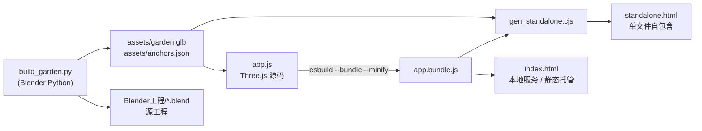

# 借星 · 网师园的轨道移植

> **2140 年，人类把一座中国古典园林整体搬进近地轨道舱。**
> 园外已无景可借，于是月洞门成了舷窗，漏窗成了观察窗——
> 八百年的「借景」，在星海里被重新借了一次。

**Blender 程序化建模 + Three.js 第一人称空间漫游** · 运行时零外网依赖 · 单文件版双击即开

> 参赛作品 · 第十四届全国大学生数字媒体科技作品及创意竞赛 · 主赛道 · 指定命题类赛项 1「科幻 + 元宇宙数字作品」

---

## 目录

- [快速开始](#快速开始)
- [作品概念](#作品概念)
- [空间序列 S1–S5](#空间序列-s1s5)
- [核心创新：把「借景」翻译成可论证的规则](#核心创新把借景翻译成可论证的规则)
- [技术实现](#技术实现)
- [仓库结构](#仓库结构)
- [从源码完整重建](#从源码完整重建)
- [操作说明](#操作说明)
- [修复记录](#修复记录)
- [已知取舍](#已知取舍)
- [第三方资源与许可](#第三方资源与许可)
- [匿名化说明](#匿名化说明)
- [License](#license)

---

## 快速开始

三种方式任选其一，**都不需要联网**。

### 方式一：单文件版（零依赖，评审机最稳）

直接双击 [`standalone.html`](standalone.html)。

模型、锚点数据、three.js 全部内嵌在一个 HTML 文件里，不启动任何服务、不请求任何外部资源，双击即进。

### 方式二：一键启动本地服务（推荐）

```bash
./start.command
```

macOS 下双击 `start.command` 即可。脚本会清理 8802 端口上的陈旧服务、启动 `python3 -m http.server 8802`，并自动打开浏览器（URL 带时间戳，强制刷新、杜绝旧缓存）。

> 首次双击若提示「无法打开」，右键 → 打开，或在 *系统设置 → 隐私与安全性* 中点「仍要打开」。

### 方式三：任意静态托管

把整个仓库当作静态站点发布即可（`index.html` + `assets/` + `app.bundle.js`），无需任何后端。

> ⚠️ `index.html` **不要**直接双击打开：浏览器的本地文件安全策略会拒绝加载 `.glb` 模型。
> 必须经本地服务访问，或改用 `standalone.html`。

---

## 作品概念

**时间**：2140 年。地球生态系统临界，人类启动「方舟计划」。

除物种种子库与数据档案外，计划委员会做出一项非常规决议——**把一座中国古典园林整体移植进近地轨道舱**。
理由是：长期深空移民的心理崩溃率是工程失败的首要原因，而园林是被验证过千年的「心理维生系统」。

**被选中者**：苏州**网师园**。

> 网师园占地仅八亩，却是中国园林里「以小见大」的极致。更重要的是，它的**殿春簃**早在 1980 年就被整体复制进纽约大都会博物馆（明轩 Astor Court）——它是中国园林第一次真正意义上「被搬走」的实例。
> 八百年后，人类第二次搬走它，这一次搬向轨道。

### 设定中「借景」的转译

中国园林的核心手法是**借景**：在墙上开一扇月洞门、一排漏窗，把园外的山、水、天光借进来，让有限的空间获得无限的景深。

**在轨道舱里，园外已无景可借。** 于是人类把舷窗开在月洞门的位置、把星海与地球借进园中：

| 园林手法 | 原语义 | 轨道条件下的转译 | 实现 |
|---|---|---|---|
| 借景 | 借园外山水天光 | 借星海与地球 | 月洞门 ＝ 舷窗 |
| 框景 | 用门洞窗棂裁切风景 | 用舱体结构裁切星空 | 漏窗 ＝ 观察窗阵列 |
| 移步换景 | 路径控制视点序列 | 漫游路径即叙事节奏 | 五段空间序列 |
| 以小见大 | 八亩见天地 | 舱内有限容积见宇宙 | 池面倒映星空 |
| 天光云影 | 水面倒映天象 | 微重力水面倒映星象 | 水面材质 + 起伏 |

这就是作品名**《借星》**的来源：借景手法在轨道条件下的转译。

---

## 空间序列 S1–S5

中国园林的本质是**空间叙事语法**——用「抑—扬—抑—扬」的序列控制游观节奏。漫游路径严格复现这一语法，同时叠加科幻层：

| # | 空间 | 园林原型 | 空间语法 | 科幻叠加层 | 触发半径 |
|---|---|---|---|---|---|
| S1 | 门厅 | 网师园门厅、砖雕门楼 | **抑**：低矮、封闭、视线压缩 | 气闸舱、舱压指示灯、编号标识 WSY-01 | 5.5 m |
| S2 | 曲廊 | 网师园复廊、漏窗序列 | **过渡**：狭长，侧向漏窗透出断续光 | 漏窗即舱体观察窗，星光被切成纹样 | 5.0 m |
| S3 | 主厅 | 万卷堂 / 看松读画轩 | **扬**：开敞，正面月洞门框景 | 月洞门即舷窗，借进来的是地球与星海 | 7.6 m |
| S4 | 彩霞池 | 彩霞池、月到风来亭、濯缨水阁、引静桥 | **高潮**：环池一周，移步换景 | 微重力水面、倒映星空、池底全息水流线 | 10.5 m |
| S5 | 殿春簃 | 殿春簃、冷泉、湖石、半亭 | **余韵**：小而静，收束 | 生态维生舱，真实绿植与活水 | 6.5 m |

走近任一锚点，屏幕下方会自动浮出该空间的**空间语法说明**与**园林原型出处**；顶栏 S1–S5 标记已抵达的空间，左下角实时提示「下一站」的方位与距离。

---

## 核心创新：把「借景」翻译成可论证的规则

作品不是「古建 + 飞船」的视觉拼贴，而是提出一条**可论证的转译规则**：

> 中国园林的「借景 / 框景 / 移步换景」本质上是一套**空间叙事语法**，与元宇宙的空间序列设计同构；
> 本作品把这套语法移植到轨道舱语境，验证它仍然成立——**传统空间语法可以成为虚拟空间设计的方法论，而不只是视觉素材**。

这条论点不是写在设定里的装饰，而是在代码里被真正执行的：五个锚点的坐标、半径、文案与其所承载的空间语法一一对应（见 [`assets/anchors.json`](assets/anchors.json)），漫游的碰撞盒按真实构件形制排布（见 [`app.js`](app.js) 的 `COLLIDERS`），探测地图的平面轮廓与 Blender 建模参数共用同一套坐标系。

---

## 技术实现

### 建模

- **Blender 4.5.9 LTS**，全部几何由 **Python 程序化生成**（`build_garden.py`，约 800 行），无任何第三方模型 / 贴图 / HDRI
- 关键构件：反曲（举折）屋面 + 瓦垄、月洞门穿孔墙 + 木窗套、漏窗栅格、太湖石湍流位移、微起伏水面、舱体圆筒 + 天窗带 + 五面舷窗屏、星幕与星点、引静桥跨全池
- 规模：**29832 三角面 / 14 个网格 / 14 个材质 / 27 个物体**
- 导出：glTF 2.0 / **GLB 1.59 MB**（含材质与层级）

### 漫游

- **three.js r160**（`three@0.160.0`），第一人称控制 + 碰撞阻挡 + 叙事锚点 + 飞行观察 + 鼠标拖拽兜底转向
- **esbuild** 打包为 IIFE（`app.bundle.js`，547 KB），three.js 整体内联，**运行时零外网依赖**
- 坐标系：Blender (Z-up) → glTF (Y-up)，换算规则 `gx = x, gy = z, gz = -y`

### 构建管线



### 关键实现细节

| 主题 | 做法 |
|---|---|
| 碰撞 | 建筑 AABB + 水池禁入 + 引静桥处留南北通道；按 glTF Y-up 重算全部碰撞盒 |
| 锚点 | 5 个空间锚点，坐标由 Blender 侧换算，运行时按半径触发 |
| 飞行观察 | 切换后自动升舱至 7.6 m 并平滑过渡；记住上次飞行高度，不来回甩 |
| 探测地图 | Canvas 2D 绘制的舱内俯视平面图：体量、曲廊、彩霞池、锚点状态、玩家箭头与视野扇形、实时高度 |
| 无障碍兜底 | 全部功能同时提供屏幕按钮，不依赖键盘焦点；Pointer Lock 不可用时改用鼠标拖拽转向 |
| 降级 | 模型加载失败 / 超时均给出中文提示，并引导到 `standalone.html` 兜底 |

---

## 仓库结构

```
jie-xing-orbital-garden/
├── README.md                      本文件
├── LICENSE                        MIT
├── package.json                   构建脚本与依赖（three@0.160.0 / esbuild）
├── .gitignore
├── index.html                     漫游页面（引用本地打包文件，无需外网）
├── app.js                         漫游源码（Three.js：碰撞 / 锚点 / 飞行 / 探测地图）
├── app.bundle.js                  打包产物（three.js 已内嵌，547 KB）
├── standalone.html                单文件版：双击即可打开，无需启动服务
├── gen_standalone.cjs             单文件版生成脚本（含自检）
├── start.command                  双击即开本地服务并自动打开浏览器
├── assets/
│   ├── garden.glb                 场景模型（1.59 MB / 29832 面 / 14 网格）
│   └── anchors.json               五个叙事锚点的坐标、半径与文案
└── Blender工程/
    ├── 借星_网师园轨道舱.blend      Blender 4.5.9 源工程（可继续编辑）
    └── scripts/
        ├── build_garden.py        程序化建模脚本（场景由代码生成，可复现）
        └── render_preview.py      八视角渲染脚本
```

---

## 从源码完整重建

### 前置

- Node.js ≥ 18（仅重建前端时需要）
- Blender 4.5 LTS（仅重建模型时需要）

### 1. 重建前端

```bash
npm install
npm run build          # app.js → app.bundle.js（esbuild 打包 + 压缩）
npm run standalone     # → standalone.html（内嵌模型 + 锚点 + bundle）
```

`gen_standalone.cjs` 内置自检：确认生成文件中**无残留外部脚本引用**，且**每个内联脚本块都可被解析**。这防的是一个真实踩过的坑——`String.replace` 会把替换串里的 `$&` 解释为「插入匹配项」，而 three.js 压缩代码中含 `$&&` 序列，会在 bundle 中间注入假的 `<script src>` 标签导致浏览器截断脚本。因此生成时一律用 replacer 函数做替换。

### 2. 重建模型

```bash
cd Blender工程/scripts
/Applications/Blender.app/Contents/MacOS/Blender --background --python build_garden.py
```

产出 `assets/garden.glb`、`assets/anchors.json` 与 `Blender工程/借星_网师园轨道舱.blend`。

> 重生成的 `anchors.json` 与随附版本**逐字节一致**。
> 重生成的 `garden.glb` 与随附版本在 glTF 结构、网格名、材质与全部顶点坐标上**完全一致**；仅瓦片网格（`M_tile`）的三角形索引枚举顺序因 Blender 内部排序存在差异，渲染结果相同。

### 3. 渲染预览图

```bash
/Applications/Blender.app/Contents/MacOS/Blender --background --python render_preview.py
```

八视角 PNG 输出到 `renders/preview/`。

---

## 操作说明

| 操作 | 作用 |
|---|---|
| `W` `A` `S` `D` | 行走 |
| `Shift` | 加速 |
| 鼠标拖动 | 转向（点击画面可尝试锁定鼠标） |
| `F` | 切换飞行观察（切换后自动升舱，空格或「上升 / 下降」按钮继续调整高度） |
| `R` | 回到出生点 |
| `M` | 显示 / 隐藏右下角探测地图 |
| `空格` / `C` | 飞行模式下上升 / 下降 |

所有功能同时提供屏幕按钮（飞行观察 / 上升 / 下降 / 回到起点），不依赖键盘焦点，触屏与嵌入式预览面板同样可用。

---

## 修复记录

本仓库在发布前做了两轮浏览器实测（Playwright + 系统 Chrome 无头模式），覆盖模型加载、行走、飞行、锚点触发、探测地图绘制与两种加载方式。

**本仓库发布时修复的问题：**

| # | 问题 | 修复 |
|---|---|---|
| 1 | **单文件版（`standalone.html`）模式下五个叙事锚点全部失效**——模型能加载，但空间语法卡片、S1–S5 进度、下一站提示全部不工作 | 根因：`gen_standalone.cjs` 把锚点数据注入为 **JS 对象字面量**，而 `app.js` 用 `JSON.parse(...)` 解析，对对象调用会因 `[object Object]` 抛异常并被静默吞掉。修复：`loadAnchors()` 同时兼容对象与 JSON 文本两种形态 |
| 2 | 页面请求 `favicon.ico` 产生 404 控制台报错 | `index.html` 增加 `<link rel="icon" href="data:,">` |

> 原始交付版本中，「锚点全部触发」与「单文件版可用」是**分别**验证的，两者组合后才会暴露问题 1。

**更早的实测记录（原始作品已完成）：**

| # | 问题（用户实际会遇到） | 修复 |
|---|---|---|
| 3 | 出主厅被水池碰撞盒卡在月洞门内 | 池体北移 3.5 m，厅前形成庭院，石板路引至池岸 |
| 4 | 评审机无外网时永久卡在「装载 0%」 | three.js 改为本地打包，并生成双击可用的 `standalone.html` |
| 5 | 濯缨水阁 / 殿春簃碰撞盒坐标符号错误（该挡的不挡、不该挡的有隐形墙） | 按 glTF Y-up 重算全部碰撞盒 |
| 6 | 双击 `index.html` 只有一行错误黑屏 | 增加明确的中文失败提示 + `standalone.html` 兜底 |
| 7 | 彩霞池锚点半径仅 5 m，绕到池岸不触发 | 半径扩至 10.5 m 覆盖全池；其余锚点按空间尺度逐一校准 |
| 8 | 无导航感，不知道自己在哪、下一站去哪 | 顶栏 S1–S5 进度条 + 下一站方位距离提示 |
| 9 | Pointer Lock 不可用环境（部分浏览器 / 嵌入式预览）无法转向 | 增加鼠标拖拽转向兜底，并给出提示 |
| 10 | 按 `F` 切换飞行「没反应」 | 三个原因一并修：`e.repeat` 守卫长按横跳、切换后自动升舱并平滑过渡、增加屏幕按钮 |
| 11 | 用户不知道自己在哪里 | 新增右下角探测地图（俯视平面图 + 玩家箭头 + 视野扇形 + 锚点状态 + 飞行高度） |

---

## 已知取舍

答辩时可能被问到，先把答法写在这里：

1. **非精确复原**——程序化抽象再现网师园构件的**形制特征**，非测绘复原。材料中均已注明，不声称「1:1 精确复原」。
2. **舷窗为屏而非物理窗**——设定为「舱壁不设物理开孔，星景由舷窗屏实时投射」。既符合深空飞船工程惯例，也让「借景」在数字语境下完成一次转译：被借进来的星海，本身就是一块屏幕。
3. **植物为低模**——为保证网页性能，绿植为低面数抽象形体。
4. **水面为材质近似**——微重力效果由材质 + 法线起伏近似，非流体模拟。
5. **舷窗屏为静态几何**——星幕与星点为场景内几何体，不做实时天体渲染。

---

## 第三方资源与许可

| 依赖 | 版本 | 许可 | 用途 |
|---|---|---|---|
| [three.js](https://threejs.org/) | r160（`0.160.0`） | MIT | 网页端 3D 漫游渲染，已内联进 `app.bundle.js` |
| [esbuild](https://esbuild.github.io/) | 0.24.2 | MIT | 前端打包（仅构建期使用，不进产物） |
| Blender | 4.5 LTS | GPL（仅工具，不随代码分发） | 程序化建模与离线渲染 |

**场景资产**：全部为自建几何 + 自写材质，**不使用任何第三方模型、贴图或 HDRI**。模型、材质、贴图均无外部授权负担。

**系统字体**：`PingFang SC` / `Hiragino Sans GB` / `Microsoft YaHei` / `system-ui`（均为操作系统自带字体，未内嵌字体文件）。

---

## 匿名化说明

本仓库为**脱敏后**的公开版本：

- 源码、脚本、模型与配置中**不含**任何个人身份信息：所属单位、作者真实姓名、学籍信息与联系方式均已移除
- Blender 工程文件中的本机绝对路径已做等长二进制替换（保持文件结构与全部偏移不变），经 Blender 4.5.9 无头模式验证可正常打开
- 未包含参赛承诺书、证件影像、报名表、视频、评审材料等任何非源代码文件

---

## License

本项目源码以 [MIT 许可证](LICENSE) 开源。

`app.bundle.js` 与 `standalone.html` 内联了 three.js r160（MIT），版权声明随 three.js 源码保留。
